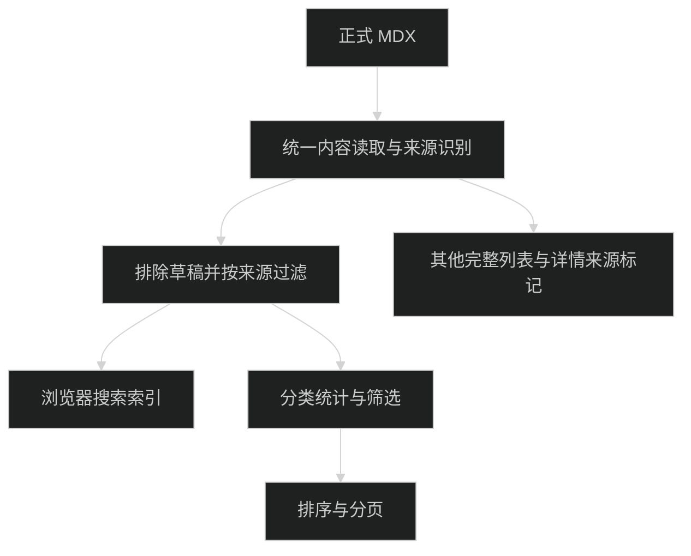
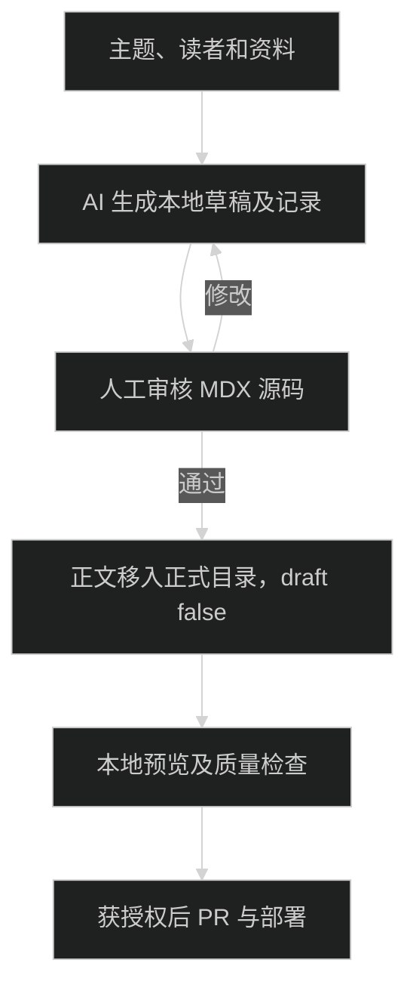

# AI 文章来源过滤与仓库写作设计

## 契约

- `BlogPost.aiGenerated: boolean`，读取 `data.aiGenerated === true`。缺省、false 和非布尔值均为 false。
- `BlogSourceFilter = 'all' | 'human'` 放浏览器可用元数据模块。URL 缺省为 all，仅 `source=human` 启用非 AI；未知值按 all。
- 共用 `buildBlogListUrl({ source, category, sort, page })` 构造主列表 URL；默认值省略，来源/分类/排序切换不保留页码。
- 来源纯筛选函数接受文章数组和筛选值，不读取文件。来源过滤后的已发布完整数组供搜索使用；分类过滤、排序和 8 篇分页只作用于普通列表。
- 分类计数随来源变化；主题标签侧栏、精选专栏、RSS、sitemap 继续全量。
- 服务端 `getBlogListData(allPosts, options)` 统一生产列表顺序，页面直接调用；测试使用真实读取的 fixture 调同一函数，防止来源过滤错误地发生在分页后。

## UI 和状态

- 来源切换是独立常驻导航，在 `BlogSearch` children 外，不被搜索结果替换。
- 保持 `BlogSearch` 组件位置和 key 不变；同路径 Next Link 查询参数导航只更新 posts 与 children，现有 useState 搜索词保留。
- 来源零结果不卸载搜索。分类、排序和分页沿用原搜索隐藏行为。
- `PostCard` 接收可选当前来源，搜索透传，分类眉标链接保留来源；其他页面默认 all。
- 统一无 Node 依赖的来源标记组件，只渲染“AI 生成”文字，沿用 `font-mono text-xs text-muted-foreground`。
- 首页文章 entry 携带来源；笔记不新增来源体系。归档和专栏预览补相同标记，不过滤导航。
- 不改变文章标题、布局、现有设计色彩或动画。

## 本地写作

`content/drafts/<slug>/post.mdx` 和 `generation.md` 被 Git 忽略，现有读取层只扫描 blog，草稿无需改变服务端结构。

共享技能安装于 `/Users/wuwanzhu/.agents/skills/xdd-blog-writing/SKILL.md`。识别当前 Git 仓库或 worktree 的远端与项目规范；不匹配时停止落盘。规范引用项目内文件，不复制第二套字段/组件清单。

默认输出 `aiGenerated: true`、`draft: true`。主要正文由 AI 起草即标记，人工修改不抹掉来源；纠错、排版辅助不改变人工文章来源。生成记录写要求、资料来源和待核验事实，不包含凭据或系统提示词。同名文件不自动覆盖，更新已有内容需要明确指令。

构建不读取 drafts，不能作为初稿校验。源码审核通过后移入本地 blog，再通过 dev/build 验证渲染。生成记录留在 drafts；不引入生成脚本、正文 API、数据库或自动 Git 操作。

## 兼容与发布

旧文章缺省 false，无迁移。AI 摘要哈希、模型和独立关闭开关保持现有行为。只在用户确认摘要后提交或推送；未经授权不合并或部署。回退本次改动即可恢复现有列表，MDX 中多余来源字段不会影响旧读取层。
