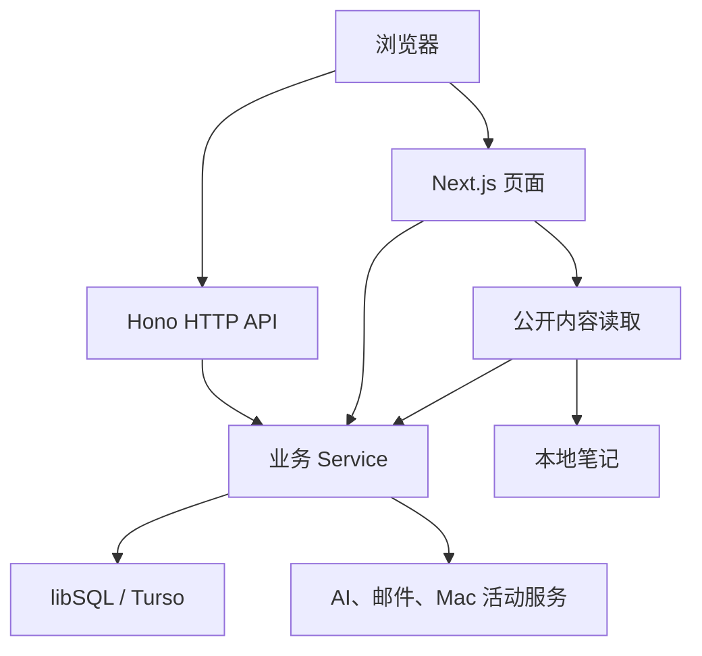

# 架构与目录

Next.js 16 + React 19 + TypeScript strict + Tailwind CSS 4，App Router 单应用。HTTP API 使用 Hono；数据存入 libSQL/Turso，由 Drizzle 管理。文章保存数据库 MDX 原文和公开快照，笔记保留本地 Markdown。

## 运行与数据边界

- [server.ts](../server.ts) 是开发和生产入口，默认监听 `127.0.0.1:4400`；`HOST`、`PORT` 可覆盖。启动通过 `pnpm dev` 或 `pnpm start`，不绕过该入口运行另一套服务器。
- 普通 HTTP 交给 Next.js；`/api/*` 由 catch-all Route Handler 转发到 [Hono 应用](../src/server/app.ts)。`/api/visitors/socket` 的 WebSocket upgrade 由 `server.ts` 直接分流，不经过 Hono HTTP 路由。
- RSC、Server Actions 和离线脚本在进程内读 Service，不向自己的 `/api` 发 HTTP。浏览器动态交互走 API，搜索由 RSC 下发公开数据后在内存完成。具体调用约定见 [API](api.md)。
- [src/lib/content.ts](../src/lib/content.ts) 是公开内容读取入口；文章异步读 posts Service 的已发布快照，React cache 仅做单次 RSC 请求去重。笔记同步读 `content/notes/`。
- Mac 活动采集器在仓库外，Blog 只代理公开状态。访客在线连接是本应用内的另一套能力，不能与 Mac 活动混为一谈。

## 顶层路径

| 路径                                 | 职责                                                                         |
| ------------------------------------ | ---------------------------------------------------------------------------- |
| `src/app/(site)/`                    | 公开页面和管理页；路由组不增加 URL 前缀                                      |
| `src/app/(site)/_components/<功能>/` | 页面组件，按 site、home、blog、notes、comment、links、visitor、admin 分组    |
| `src/server/modules/<域>/`           | posts、auth、comments、links、ai、presence、visitors、admin、system 业务模块 |
| `src/server/infra/`                  | 数据库、模型客户端、凭据加密、邮件等跨模块基础设施                           |
| `src/server/shared/`                 | 跨模块无状态工具，统一响应封装等                                             |
| `src/lib/`                           | 内容读取、浏览器可用 Schema、日期、搜索与协议等入口                          |
| `src/site.config.ts`                 | 站点标题、导航、社交链接与正式域名                                           |
| `src/profile.config.ts`              | 个人简介、技术栈、经历与教育                                                 |
| `content/notes/<slug>.md`            | 本地笔记；目录不存在时读取空列表                                             |
| `content/drafts/`                    | 可选本地草稿，被 Git 忽略，不是公开内容源                                    |
| `scripts/`                           | 数据库连通性检查、摘要同步等已有维护入口                                     |
| `docs/`                              | 本项目的主题文档与索引                                                       |

`content/blog/<slug>/post.mdx` 已不是线上内容源；本地文章通过后台导入为工作稿。编辑和发布契约见[内容管理](content.md)。笔记路径由 `process.cwd()` 锚定仓库根，不随源码目录移动。

`src/app/` 还包含根布局、字体加载、全局样式、not-found、sitemap、robots 和 RSS。字体文件位于 `src/app/fonts/`。路径别名 `@/*` 指向 `src/`。

## 页面与组件放置

页面文件用 `page.tsx` 和 default export，布局用 `layout.tsx`。根布局管 metadata 模板与主题防闪烁；站点布局放共享页头、页脚和背景。

不在仓库根另建 `app/` 或 `pages/`，不建第二套 `src/components/`。页面私有组件不移到 `src/lib/`，也不按 ui/common 另建顶层组件分组。管理后台已有 `admin/ui/` 是 shadcn/Radix 基础组件目录，继续复用；AI 业务组件放 `admin/ai/`。

管理页面和 API 分别鉴权。服务端页面读取 session 并用 `isSiteAdmin` 校验站长，未登录或非站长调用 `notFound()` 隐蔽路由；metadata 禁止索引、跟随和缓存。不能只靠隐藏前端入口保护后台。

## 服务模块放置

| 文件              | 职责                                                             |
| ----------------- | ---------------------------------------------------------------- |
| `<域>.service.ts` | 业务逻辑、数据库读写、状态转换和领域错误                         |
| `<域>.route.ts`   | HTTP 输入解析与校验、调用 Service、映射响应和状态码              |
| `<域>.types.ts`   | 该域公共入参、DTO 和展示类型；已有浏览器共享 Schema 留在 src/lib |

一个模块可按子功能拆文件，不强制每个域只有这三个文件。新增模块在 `src/server/app.ts` 链式挂载；`AppType` 从 `typeof app` 推导。

跨模块调用对方导出的 Service 或公共类型，不读取私有状态，不在模块外建 re-export 过渡文件。技术适配放 `infra/`，无状态跨域工具才放 `shared/`；不在 server 根目录平铺第二套 routes/services。页面不直接写复杂 SQL，公开内容不在组件里直接读文件。
