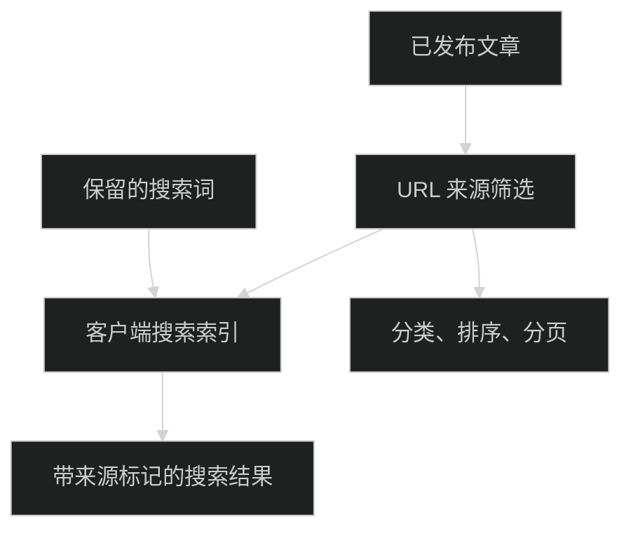

# 站内搜索

## 范围与依据

改动全局搜索弹窗、搜索索引、匹配打分、高亮渲染或 `/blog` 列表页搜索框时，检查本文件。

本文件依据 `src/lib/search.ts`、`src/app/(site)/_components/blog/blog-search.tsx` 与 `post-card.tsx` 核对。

## 全局搜索弹窗

右上角按钮、`⌘K` / `Ctrl+K` 和 `open-command-search` 事件打开同一个搜索弹窗。它检索页头收到的文章元数据；下文的正文索引、评分与高亮用于 `/blog` 列表搜索，不用于全局弹窗。

- 弹框从搜索按钮的实际位置展开，入场 420ms，退场 300ms；内容稍后显现，关闭时先淡出内容，再将轮廓收回按钮。
- 关闭按钮、Escape 和遮罩均触发退场；动画结束后隐藏浮层、清空查询并解除背景滚动锁定。关闭过程中重新打开，从当前画面反向继续。
- 按钮触发与快捷键共用按钮作为动画起点。页头因滚动隐藏时，打开搜索先恢复页头；普通关闭归还原焦点，结果跳转不抢回焦点。
- 保留 Tab 焦点捕获、方向键选择与输入框 Enter 跳转；输入法组合期间不处理这些搜索快捷操作。关闭按钮和清空按钮支持键盘激活。
- 减少动态效果时直接切换状态；动画期间窗口或可视视口尺寸变化、页面进入后台时结束当前过渡，避免残留变换。窄屏用 `dvh` 限制浮层高度，结果区可独立滚动。

实现见 [搜索弹窗](../src/app/%28site%29/_components/site/command-search-modal.tsx)、[开合动效](../src/app/%28site%29/_components/site/use-search-motion.ts)和[页头入口](../src/app/%28site%29/_components/site/site-header.tsx)。来源：本次用户确认的搜索按钮展开与收回可视化。以上是实现说明，不替代浏览器验收。

## 数据流

RSC 页面先读取已发布快照、再按 URL 来源筛选，把完整结果交给 `BlogSearch`（client 组件），索引与匹配全在浏览器内存里完成：

```tsx
// src/app/(site)/blog/page.tsx
<BlogSearch
  posts={sourcePosts}
  currentSource={activeSource}
  sourceSwitch={
    <BlogSourceSwitch currentSource={activeSource} currentCategory={activeCategory} currentSort={activeSort} />
  }
  toolbar={
    <BlogToolbar
      currentCategory={activeCategory}
      currentSort={activeSort}
      currentSource={activeSource}
      categoryCounts={categoryCounts}
    />
  }
  sidebar={tags.length > 0 ? <BlogSidebar tags={tags} /> : null}
>
  {/* 普通列表与分页器 */}
</BlogSearch>
```

不建搜索 API route，不引入搜索库。索引在 `useMemo` 里按 `posts` 引用建一次，输入变化只重跑匹配；未输入时渲染 `children`（服务端渲染的原列表）。



## 剥离口径

`stripNonText` 决定哪些文字进索引：

| 内容              | 处理                     |
| ----------------- | ------------------------ |
| 反引号围栏代码块  | 整块丢弃                 |
| 行内代码          | 保留文字                 |
| KaTeX 公式        | 丢弃                     |
| MDX import/export | 丢弃                     |
| JSX 标签          | 丢弃标签，保留标签内文字 |
| 图片语法          | 整块丢弃                 |
| 链接              | 保留可见文字             |

行内代码保留文字，因为技术名词常写在反引号里；围栏代码块整块丢弃，因为里面的标识符不是文章主题词。剥离后统一压空白，结果存进 `SearchDocument.text`。

## 匹配、打分与排序

- 关键词含中日韩字符时按子串匹配，不做分词；纯英文数字关键词要求落在词首，大小写不敏感，`-` 等非字母数字字符算词边界。
- 查询按空白拆词，多词是 AND：任一词在所有字段都没命中，整篇淘汰。
- 去空白后不足 2 个字符直接返回空数组，避免中文虚词刷出弱相关条目。
- 字段权重：标题 5、标签 3、分类 3、描述 3、正文 1。同一关键词在同一字段只计一次，多个关键词的得分累加。
- 得分 0 不返回；结果按得分倒序，同分按发布日期倒序。

## 高亮坐标契约

`SearchHit` 里两组区间的坐标系不同，不要混用：

| 字段            | 坐标相对     | 渲染位置 |
| --------------- | ------------ | -------- |
| `titleRanges`   | `post.title` | 标题     |
| `snippetRanges` | `snippet`    | 正文片段 |

`snippet` 为 null 表示标题已命中，此时列表显示 `post.description` 原文；标题未命中而正文命中时，`snippet` 取代描述位。

`lowerAligned` 尝试 `toLowerCase()`，小写后长度改变时退回原文，避免高亮坐标错位；这类特殊字符可能失去大小写不敏感。查询词仍小写化。不用 NFKC，因为它也可能改变字符长度。

## 列表页行为

- 搜索框在 `/blog` 标题下方，输入即过滤，没有提交按钮。
- 搜索态隐藏分类工具栏，用结果替换列表与分页器，清空后恢复；搜索输入期间不发网络请求。
- 普通列表和搜索结果使用同一个响应式网格。有标签时 lg 起约 3:1 双栏，侧栏在搜索前后保留；无标签时页面传入 `sidebar={null}`，网格使用单列，列表与工具栏等宽。不能仅让 `BlogSidebar` 返回 `null`，却保留双栏占位。搜索状态不改变列宽。
- 搜索范围为当前来源筛选下的全部已发布文章，不受当前分类筛选与排序影响。
- 来源切换通过 `sourceSwitch` 槽位传入，放在 `children` 外、搜索框旁，在搜索态和零结果时都可见。切换是同 `/blog` 路由的 Next Link 导航，会更新服务端传入的文章集合。
- 同路由切换来源时保持 `BlogSearch` 位置与 key 不变，保留其 `useState` 搜索词；不要因来源集合为空而卸载组件。
- 搜索结果向 `PostCard` 透传当前来源，分类眉标链接保留来源。来源切换清除页码并保留当前分类和排序，分页链接也保留来源。

验收至少覆盖这两对：正文命中的词能搜到（证明正文进索引），只出现在代码块或公式里的标识符搜不到（证明已剥离）；高亮区间能用 `text.slice(range.start, range.end)` 还原关键词。

来源过滤验收：同一词同时命中人工与 AI 文章，切到非 AI 后仅保留人工命中，输入框不清空；当所有命中都是 AI 时，零结果仍可切回全部；分类、排序和分页链接不会丢失 `source=human`。

## 已确认约定与现状差异

[DESIGN.md](../DESIGN.md)与原无标签单列修复需求保留“有标签时双栏间隔 32px”的约定。当前 [BlogSearch](../src/app/%28site%29/_components/blog/blog-search.tsx)使用 `lg:gap-x-10`，默认为 40px；无标签时仍为单列。本轮仅记录偏差，不把现有实现自动改写成新的设计决定，也不修改业务样式。

源码入口：[搜索算法](../src/lib/search.ts)、[列表数据与布局](../src/app/%28site%29/blog/page.tsx)。以上行为描述依据源码，不替代真实浏览器验收。
